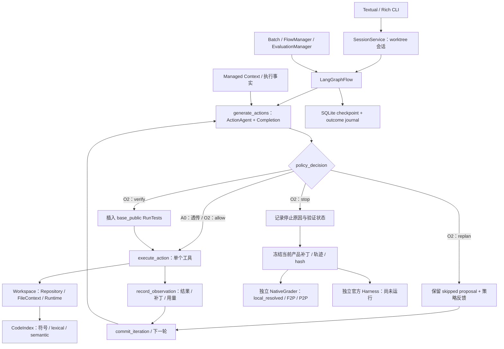

# RepoForge：代码库级 Coding Agent

[English](README.md) | 中文

本项目实现一个完整的代码库级 Coding Agent：接收 issue，在目标仓库中完成任务理解、代码定位、上下文管理、补丁编辑、测试验证和补丁交付，并通过隔离的评估流程检查最终修复结果。核心设计为 **LangGraph 可恢复执行、版本感知 Managed Context、本地代码检索、编辑/测试工具，以及独立 native 判题与证据保留**。

项目提供 **O2 fixed（配置名 `a5`）** 与 **A0（`action_policy.variant="off"`）** 两种完整运行配置。它们使用相同执行框架、上下文、检索和工具，分别开启/关闭 ActionPolicy，用于项目内部的受控配对评估。O2 是确定性的推理时策略，不涉及策略网络训练。

## 当前状态与证据

| 项目 | 已有证据与边界 |
| --- | --- |
| 执行框架 | 已实现 LangGraph 图节点、逐动作执行、SQLite checkpoint、outcome journal 和工作区指纹核对 |
| 交互终端 | Textual/Rich + SessionService，支持独立 Git worktree、续聊、取消、恢复及导出；当前 CLI 仅允许策略关闭 |
| 上下文与检索 | Managed Context 按 token 预算投影执行事实；代码检索提供符号/标识符搜索、语义检索及 lexical fallback；A0/O2 共用 |
| 系统总体结果 | dev30与holdout50合计80题，O2 **46/80（57.5%）**、A0 **44/80（55%）native `local_resolved`**；包含一例已记录的判题规则修正 |
| 组件能力 | O2在80题中已记录上下文构建的估算输入预算符合率100%（32K）；累计前5个实际搜索/浏览文件的定位命中率 **71/80（88.75%）** |
| 配对评估 | **160/160完成判题、80对、0缺失**；O2点估计+2.5pp，95% bootstrap区间[-5,+10]pp，证据尚不足以确认稳定策略增益 |
| 验证状态 | 内部公开测试证据与最终独立判题分开；`verified`不等于`resolved` |
| 官方 SWE-bench Harness | **`not_run`**，`official_resolved=null`；本地结果不代表官方成绩 |

当前正文统一采用80题总体结果，原dev30/holdout50来源标签保留于[分组报告](docs/evaluation.md)；[合并复核](reports/o2-a0/combined.json)包含成本与79对敏感性。57.5%为内部评估集、单次配对及native口径，不称为80题留出或官方全量成绩。指标定义见[项目交付说明](docs/project_resume.md)。

最终80题结果、补丁与异常裁定见[评估发布包](reports/o2-a0/README.md)，配置与源码指纹随包保存。费用为生成侧项目参考估算，本地embedding硬件费用未计价。

## 当前架构



图中 O2 控制器用于 batch。CLI 与 batch 共用图执行基础，但工具组合和配置入口不同；终端演示不能直接当作 O2 实验。

| 模块 | 职责与源码入口 |
| --- | --- |
| 执行与状态 | [LangGraphFlow](repoforge/flow/langgraph_flow.py) 拆分 prepare、generate、policy、execute、record、commit；[GraphState](repoforge/flow/graph_state.py) 保存业务快照与动作游标 |
| 恢复 | [durable.py](repoforge/flow/durable.py)、[checkpoint 裁剪](repoforge/flow/pruning_checkpointer.py) 保存执行记录与状态；先核对配置和工作区，已确认动作不重放，未知副作用报恢复冲突 |
| Agent 与工具 | [ActionAgent](repoforge/agent/agent.py) 生成和执行结构化动作；[Actions](repoforge/actions/) 提供读、搜、改、测与结束；[Completion](repoforge/completion/) 封装模型响应和用量 |
| 上下文 | [ManagedMessageHistoryGenerator](repoforge/message_history/managed.py)、[ContextPolicy](repoforge/message_history/policy.py) 依据 token 预算组织当前代码、观察、执行事实与版本引用，不使用 LLM 摘要 |
| 检索 | [CodeIndex](repoforge/index/code_index.py)、[lexical](repoforge/index/lexical.py)、[RRF](repoforge/index/hybrid.py)；历史 native 实验使用本地 BGE-M3/FAISS，索引身份绑定仓库、base commit 与 embedding 配置 |
| O2 策略 | [ActionPolicy](repoforge/policy/action.py) 提取补丁、动作签名、进展、失败和预算特征，输出 `allow / replan / verify / stop` |
| 验证与导出 | [verification](repoforge/evaluation/verification.py) 判断测试与当前产品补丁的绑定；[generation](repoforge/evaluation/generation.py) 导出当前产品补丁；[NativeGrader](repoforge/evaluation/native_grading.py) 在冻结后独立判题 |
| 会话与调度 | [SessionService](repoforge/cli/service.py) 管理本地会话；[Runner](repoforge/runner/) 保留 Asyncio/Kubernetes，既有 Storage 后端继续保留 |

`AgenticLoop` 用于迁移对照，`SearchTree` / `OneOffFlow` 保留兼容；O2 主线没有启用树搜索。A6/A7 为历史研究，保存在 `preserve-agent-architectures` 分支的 `ccb91158`，不属于当前最终路径。原网页、FastAPI 后端和自定义 Docker 启动路线已退出。

## O2 fixed 相对 A0 改了什么

A0 和 O2 共用 `code_and_test` 的 system prompt、工具 schema、模型和 Managed Context。O2 在**模型提出动作之后、实际执行之前**检查提议；策略反馈进入后续正常模型调用，不额外发起独立反思调用。

| 信号 | O2 的控制行为 |
| --- | --- |
| 重复动作、连续无进展 | 根据动作参数、相关文件版本和环境识别重复；在适用分支先给予有界验证或重规划，再停止 |
| 已修改产品代码 | 单文件通常 3 次编辑后验证；多文件或当前有失败时阈值为 1 |
| 验证失败或新增回归 | 根据 failure kind / signature 和 introduced failures 提示定向修复；同一 correction key 限制重复干预 |
| 接近轮数/费用上限 | 为验证预留预算，或明确停止；费用不完整时停止。费用上限为软边界 |
| 提出 `Finish` / `VerifiedFinish` | 检查是否有产品补丁，以及当前补丁是否有有效公开测试证据 |
| 答案导出 | a5 默认排除测试修改，只交付当前产品补丁；完整轨迹保留，不自动回退历史绿补丁 |

`verify` 插入 `RunTests(test_source="base_public")`：在公开基准测试上验证当前产品修改。`replan` 保留未执行提议并反馈原因；`stop` 明确记录未验证状态。公开测试通过只说明已运行的检查通过，`VerifiedFinish` 的名称也不能替代独立判题。

## 安装与本地体验

项目包、CLI、配置目录及环境变量已统一为RepoForge；已有安装请参考[命名与迁移说明](docs/renaming.md)。

Python 范围为 3.10–3.13；CLI 首批验证面向 Linux/Python/pytest 仓库。模型调用需要配置相应服务的密钥和网络。

```bash
git clone https://github.com/Bo1222/IssueAgent.git RepoForge
cd RepoForge
uv sync --frozen
cp .env.example .env
# 在 .env 中按需填写密钥；不要提交密钥。

# 普通聊天
uv run repoforge chat --model deepseek/deepseek-chat
# 代码任务：来源仓库必须干净
uv run repoforge chat --repo /path/to/clean-repo --model deepseek/deepseek-chat
uv run repoforge run --repo /path/to/clean-repo --task-file task.md --export /tmp/task-export
uv run repoforge resume SESSION_ID
```

Enter 发送，Shift+Enter 换行；`/diff`、`/tests`、`/usage` 查看结果，`/export PATH` 导出，`/apply` 预览并确认后应用到来源仓库。修改默认保留在独立 worktree，不自动提交。CLI 无需 Docker 或向量索引，worktree 隔离代码目录，工具仍以当前账号权限运行。完整说明见 [CLI 文档](docs/interactive_cli.md)。

**当前 `SessionService.create()` 拒绝非 off 的 ActionPolicy，包括 `repoforge run`。** O2 通过 batch 生成器运行，不存在已接通的 `repoforge run --policy a5` 命令。

## A0 / O2 fixed 内部配对评估

**项目主线是完整 Coding Agent 的任务闭环与系统能力。** A0/O2是项目内部的两种策略配置；对照用于判断动作控制的额外作用，Memory、检索、工具和环境都是完整系统的组成部分。

主对照冻结相同源码与共同配置，仅切换策略并统一产品补丁导出方式：

```json
{
  "a0_control": {
    "flow": "graph", "managed": true, "correct_test_prompt": true,
    "submit_product_only": true,
    "action_policy": {"version": 1, "variant": "off"}
  },
  "o2_fixed": {
    "flow": "graph", "managed": true, "correct_test_prompt": true,
    "submit_product_only": true,
    "action_policy": {"version": 1, "variant": "a5"}
  }
}
```

这是**实验 profile 规格片段**；实际manifest和配置由独立batch入口冻结。`a0_control`是同源码的策略关闭配置，不是功能删减版，也不是CLI策略开关。

1. **共同条件**：模型、prompt、工具、Memory、检索、环境、预算、导出与判题协议一致；动态策略反馈属于实验处理。
2. **smoke**：五题用于执行、配置和隔离检查，单列报告。
3. **dev30**：每臂一次共60 jobs，A0 12/30、O2 14/30；差值+6.67pp，区间跨0。
4. **holdout50**：每臂一次共100 jobs，A0/O2均32/50；各有3题独有成功，净差值0pp。
5. **合并与例外**：正文合并80题，O2 46/80、A0 44/80，点估计+2.5pp；保留原分组与异常裁定，排除django-10097后的79对差值为+1.27pp。

**当前实验仅保留两组：**

| 组别 | 定义 |
| --- | --- |
| A0 control | 完整共同底座，ActionPolicy 关闭，模型自行选择动作 |
| O2 fixed | 相同底座，开启最终 a5 ActionPolicy |

正式评估合计80题、160 jobs，另有10个smoke jobs；运行次数不能作为任务数。80题总体有40题共同成功、A0独有4题、O2独有6题、共同失败30题；单次结果显示+2.5pp正向点估计，尚不足以确认稳定策略增益。原开发与留出的用途区别保留在详细报告中。

组件展示聚焦输入预算符合率、代码定位覆盖、版本失效与测试回执契约、评估完整性及恢复案例。调用/构建次数和token累计量保留作运行诊断。文件定位覆盖包含交互式搜索与浏览，不作为单查询向量Recall@K；也不据此断言检索不再是瓶颈。

独立实验入口：`python -m scripts.paired_experiment prepare/audit/preflight/run/status --output PATH`，支持冻结配置、环境准备、分阶段生成/独立判题和配对报告。参数与恢复边界见 [运行说明](O2_A0_EXPERIMENT.md)，当前成绩见[冻结结果报告](docs/evaluation.md)。

## 补丁生成与独立判题

生成阶段仅提供公开任务和运行材料；冻结补丁、轨迹与 hash 后，再在独立副本执行判题。参考产品补丁、隐藏测试、F2P/P2P 标签与判题结果不得进入生成上下文。自建测试单独记录，不能替代回归测试。

现有 predictions 可独立调用已锁定依赖中的标准 Harness；它需要 Docker，与本地 CLI 的运行要求不同：

```bash
uv run --frozen python -m swebench.harness.run_evaluation \
  --dataset_name princeton-nlp/SWE-bench_Verified \
  --split test \
  --predictions_path predictions.jsonl \
  --max_workers 1 \
  --run_id o2-fixed-independent-grading
```

predictions 每行包含 `instance_id`、`model_name_or_path`、`model_patch`。不同实验臂使用独立文件与 run ID。报告区分原始失败复现、补丁可应用性、FAIL_TO_PASS、PASS_TO_PASS、native `local_resolved` 和标准 Harness 结果；实际运行前官方状态保持 `not_run`。

## 完整项目与简历表述

| 设计重点 | 实现与展示 |
| --- | --- |
| 任务执行闭环 | issue接入、代码定位、编辑、测试、补丁交付、会话与独立评估 |
| 状态与上下文 | LangGraph、checkpoint、动作游标、工作区指纹；版本感知上下文与代码检索 |
| 验证与交付 | 测试回执绑定当前补丁和测试输入、证据失效、独立native判题、异常恢复与裁定 |
| 内部受控评估 | A0/O2策略开关对照、完整配对、成本归属、敏感性与复现材料 |

> **RepoForge：代码库级 Coding Agent 自主修复与验证系统**
>
> **项目描述：** 面向真实代码仓库设计完整Coding Agent，完成issue理解、代码定位、补丁编辑、测试验证与结果交付，支持多轮工具执行、会话恢复和独立评估。
>
> **项目内容：**
>
> 1. **Agent Runtime与执行恢复：** 使用LangGraph编排动作生成、策略判断、工具执行与观察提交，以GraphState维护动作游标和版本快照；结合SQLite checkpoint、OutcomeJournal与工作区指纹，按已确认结果恢复执行，对未确认副作用进行冲突检测，支持跨进程续跑。
>
> 2. **Agent Loop与工具执行：** 实现Model → ActionStep → Policy → Tool → Observation闭环，以Pydantic Schema和动作类型映射统一读、搜、改、测工具；将同轮多工具请求拆为顺序执行步骤，逐动作判断、记录结果并推进游标。编辑采用源版本校验、目标环境Python语法预检和原子写入；测试记录补丁/输入指纹、退出码及部分结果，结合40轮迭代、超时控制和allow/replan/verify/stop实现验证调度与失败反馈。
>
> 3. **版本感知上下文管理：** 实现请求级Managed Context，每轮从完整轨迹投影任务、当前代码、执行事实及测试证据；在32K估算输入预算内优先保留必需信息和最近两组完整交互，对工具输出按4,000 tokens上限截短，以文件hash和工作区版本识别过期/重复读取；通过source_id保留原文回读，超预算时压缩近期工具结果并整组裁剪历史，发送前将system prompt与工具schema纳入预算复核，保持tool-call/result配对并区分当前与过期测试证据。
>
> 4. **代码检索与定位：** 构建本地BGE-M3/FAISS索引，结合符号搜索、词法fallback及RRF融合，根据当前文件版本复核搜索候选；80题离线评估中，累计前5/10个实际搜索或浏览文件的定位覆盖率为**88.75%/96.25%**。
>
> 5. **Benchmark与消融验证：** 在SWE-bench Verified选取80题，固定模型、工具、上下文和预算，完成策略开启/关闭的配对实验；冻结补丁后独立执行native判题，最终配置解决率**57.5%（46/80）**，关闭策略为**55%（44/80）**，点估计**+2.5个百分点**；完成**160/160次判题、0缺失**，保留配置、补丁及异常裁定证据。

评估口径：80题为内部总体评估集，策略差值为单次点估计，尚不足以确认稳定增益；修复率采用native判题及已记录的规则修正口径，官方Harness未运行。文件定位指标按任务内累计、去重后的实际搜索/浏览文件计算，命中任意参考修改文件即可，不是单查询向量Recall@K。 简历和指标见[项目说明](docs/project_resume.md)，具体数据流与边界见[Loop/Context实现说明](docs/agent_execution_context.md)。

## 开发检查与进一步阅读

以下检查无需模型调用；完整测试套件仍可能依赖外部服务和索引环境：

```bash
uv run --frozen python analysis-tools/wave2_check.py
uv run --frozen python -m pytest tests/policy tests/evaluation/test_generation_worker.py -q
uv run --frozen python -m pytest tests/flow/test_langgraph_flow.py tests/flow/test_durable_recovery.py -q
```

- [最终架构与交付结构](docs/architecture.md)
- [执行架构](docs/architecture.md) · [状态与恢复契约](docs/agent_execution_context.md)
- [80题配对评估](docs/evaluation.md) · [最终结果与生成补丁](reports/o2-a0/README.md)
- [代码检索架构](docs/architecture.md) · [托管上下文实现](repoforge/message_history/managed.py)
- [独立官方补验工具](analysis-tools/README.md) · [变更记录](CHANGELOG.md)

历史报告中的状态以记录时的源码和配置为准；本页描述当前最终路径，未把规划 TODO 计为实现或实验成绩。

源码与依赖的许可、作者归属保留在[LICENSE](LICENSE)及各模块原有声明中；相关代码来源包括 [Moatless Tools](https://github.com/aorwall/moatless-tools)。
