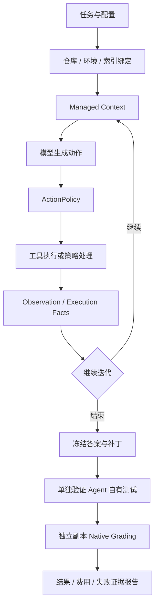

# Moatless Coding Agent Harness：简历条目、设计说明与实验数据

> 面向代码仓库缺陷修复的 Coding Agent 项目，围绕长程任务的上下文管理、执行可靠性与成本优化展开。按“简历条目 → 结构化上下文管理 → Harness → 实验数据”组织说明。
>
> 核查日期：2026-10-21。代码依据当前工作区（含已有未提交修改），HEAD 为 `2268485edb612a54e74f9c64cccdf72c84b4c4ea`。实验使用各自冻结源码与配置，不能视为当前工作区重新跑出的结果。附录见 [project-evidence.md](project-evidence.md)。

## 1. 简历条目

### Moatless Coding Agent Harness

**长程 Coding Agent 的上下文管理、工作流恢复与成本感知执行策略**

**技术栈：** Python、LangGraph、Pydantic、SQLite、Tree-sitter、FAISS、BGE-M3、pytest、Bubblewrap（native 批量实验路径）。

**项目背景：** 面向已有代码仓库中的缺陷修复任务，构建串联代码检索、模型决策、工具执行、代码修改与测试验证的 Agent 执行与评测系统，重点处理多轮执行中的上下文膨胀、历史证据过期、重复无效操作及中断恢复问题。

- **上下文管理：**构建任务导向的 Managed Context，分离原始执行轨迹与模型请求视图；按请求级 token 预算保留用户需求、执行事实和近期完整工具交互，对长输出进行头尾截短，并提供原始 Observation 分页回读；根据文件与工作区版本识别过期阅读、重复阅读和历史测试状态，记录上下文选择过程。
- **工作流与恢复：**基于 LangGraph 拆分动作生成、策略判断、工具执行、结果记录与迭代提交，使用 SQLite 操作日志和状态快照保存执行位置，结合工作区指纹检查恢复条件；对结果未确认的外部操作报告冲突，避免直接重放。
- **执行策略：**实现 A0–A4 确定性策略对照，基于重复动作、任务停滞、编辑后的验证状态与剩余预算，产生 `allow / replan / verify / stop` 决策；保留模型提案与策略安排的动作来源，支持执行归因。
- **评测与结果：**搭建无 Docker 的 native SWE-bench 兼容评测流程，冻结候选答案后在独立副本判题，复用按仓库版本与嵌入配置标识的 BGE-M3 索引。在同配置 dev30 五臂动作策略消融中，A3 本地解决数为 **17/30**，A0 为 **15/30**；每个已解决任务的项目参考成本由 **$0.1520 降至 $0.0811（约降低 46.7%）**。锁定后在 clean holdout81 上 A3 为 **46/81**、A0 为 **43/81**，配对 bootstrap 95% CI 跨 0，`hypothesis_status=insufficient_evidence`；cost/resolved 为 **$0.1005 vs $0.1562（约降低 35.6%）**。19 个非 clean 未执行并单列；官方 Harness 未运行。

**口述说明：**

> 我做的是一个面向代码修复的 Agent Harness 项目，主要关注长任务执行的可靠性。每轮根据任务要求、工具记录和当前代码版本重新构建上下文，对长输出做裁剪并保留回读入口，同时识别过期代码与测试证据。执行层通过 LangGraph 和持久化记录管理恢复，实验层分离答案生成与独立判题，再用消融比较不同动作策略的修复结果和成本。目前已完成 dev30 动作策略消融与 clean holdout81 评测，A3 46/81 vs A0 43/81，成本更低但准确率差异不显著；上下文压缩本身的任务效果还没有独立验证。

**项目定位：**Agent 工程、Context Engineering、Runtime/Harness 与评测；重点展示上下文治理、执行恢复、动作策略及可复现评测能力。

## 2. 结构化上下文管理与压缩

技术来源与贡献范围：项目使用 Moatless Tools 的既有代码检索、编辑等基础能力；个人贡献应围绕实际完成的上下文治理、工作流恢复、动作策略与评测扩展说明。现有实现没有多 Agent/Skill 调度、分层 LLM 滚动摘要、长期向量记忆或 SFT/RL 训练；上游模型成绩不计入本项目实验结果。

### 2.1 信息分层：存储对象与请求视图分开

| 对象 | 保存内容 | 维护与生命周期 | 如何进入模型上下文 |
| --- | --- | --- | --- |
| `Node / ActionStep / Observation` | 用户消息、动作参数、原始工具输出、模型调用记录 | Agent 与工具执行层保存；历史输出不因请求裁剪删除 | 当前分支轨迹转换为候选交互，按预算选择 |
| `FileContext` | 文件、代码 span、patch、历史测试结果 | 随节点克隆，支持 shadow patch 和实际磁盘视图 | 传统 Compact 可渲染工作集；Managed 按已访问代码视图生成当前片段候选 |
| `TaskState` | 实际/预期行为、验收条件、计划、假设、下一步、相关文件 | 模型通过 UpdateTaskState 更新，属于模型陈述 | 启用后作为必选状态块；引用存在不等于陈述得到独立证明 |
| `RepositoryContext` | 工作区版本、文件内容 hash、规则来源与版本、读取错误 | 系统按当前仓库状态刷新 | 用于过期判断，并构造执行事实和可选规则块 |
| `execution_memory` | 测试状态、退出码、版本、失败签名、结果替代关系 | 系统从真实工具执行结果采集 | 在 execution_facts 中呈现，不能被任务笔记改写 |
| `context_build` | included、omitted、shortened、stale、deduplicated、请求 hash、估算 tokens 与实际 usage | 每次构建请求记录 | 用于审计；这些字段不等于全部自动向模型展示 |

来源：[Node](../../../moatless/node.py)、[TaskState](../../../moatless/task_state.py)、[RepositoryContext](../../../moatless/repository_context.py)、[Execution Memory](../../../moatless/execution_memory.py)。

`node.get_trajectory()` 只沿当前节点的祖先链读取历史，ReadObservation 也限定在当前分支，避免直接读取其他分支的原始结果。

### 2.2 每轮构建流程与预算

1. 绑定实际 CompletionModel，继承启用的任务笔记，刷新文件、工作区及测试证据版本。
2. 将已完成动作组装为完整交互：assistant 工具调用消息与对应 tool results 一起选择；未执行动作不伪装成成功结果。
3. 对代码阅读做 stale 检查与同版本重复读取去重，对测试展示 effective_status / superseded。
4. 长 Observation 做头尾截短，插入 `ReadObservation source_id=node_id:step_index` 引用，原文仍留在轨迹中。
5. 先选择必选内容，再保留最近 N 组完整交互，最后从新到旧加入其他单元。必选内容包括用户消息、启用的任务状态与仓库规则、执行事实和存在时的策略反馈；当前代码片段是可选内容，不保证全部保留。
6. 最近交互仍超预算时，其工具结果进一步缩至 128 tokens；仍不能放入就明确报 ContextBudgetExceeded。
7. 模型发送前再次校验估算预算，覆盖响应校验重试导致的消息增长，并记录请求与 usage。

```text
safety = max(1024, ceil(context_window × 5%))
input_budget = min(
    max_input_tokens,
    context_window - output_limit - safety
)
```

计量覆盖准备后的 system prompt、few-shot、消息、工具定义及适用的 response format。TokenEstimator 采用 tiktoken，未知模型回退到 cl100k_base；这是序列化请求估算，不保证与供应商 tokenizer 完全一致。

来源：[Agent 接入](../../../moatless/agent/agent.py)、[Managed 组装](../../../moatless/message_history/managed.py)、[ContextBuilder](../../../moatless/message_history/builder.py)、[预算与截短](../../../moatless/message_history/policy.py)、[原文回读](../../../moatless/actions/read_observation.py)。

### 2.3 压缩方法的合理性与启用边界

Managed 主要采用**规则裁剪、头尾截短、重复/过期内容替换、状态块重建和按需回读**，没有额外调用 LLM 为整个会话生成滚动摘要。传统 Compact 还会使用工具已有的 Observation.summary；SummaryMessageHistoryGenerator 也不代表调用摘要模型。搜索工具中的模型候选筛选属于检索结果选择，与历史滚动摘要分开。

工程理由是：不增加专门的摘要模型调用，行为较容易复现，原始证据仍可追溯；当前代码和测试状态比过时输出更适合指导下一步。代价是规则不能直接判断语义重要性，回读也会增加调用与延迟，需要计入评测。

**评估结论：**作为有明确预算和证据追溯要求的工程方案，这种选择合理，使用确定性截短本身不是应被否定的理由。面试中更容易被质疑的是把它包装成无损语义压缩、完整长期记忆，或用动作策略实验声称压缩提升了修复率。应能说明保留规则、信息损失、恢复入口和验证缺口，不能保证所有面试官的评价。

| 参数或入口 | 当前行为 | 边界 |
| --- | --- | --- |
| T7 / 示例输入上限 | 32768 tokens | 实际预算还受输出与安全余量约束 |
| 单条 Observation 上限 | 4000 tokens | 不是语义重要性阈值 |
| 近期交互 | 最近 2 组，紧急时结果压至 128 tokens | 依据仍以近期优先，仍可能超限 |
| 原文回读 | 每次最多 200 行 | 要求准确 source_id，不是历史全文检索 |
| TaskState | T7 与示例配置关闭 | 不能用启用笔记时的能力解释这些实验收益 |
| AGENTS.md 加载 | T7 与示例配置关闭 | 可选指导，不是执行或完成门禁 |
| 普通 CLI | 未传 context_policy 时使用传统历史生成器 | 托管预算不是所有入口的无条件默认能力 |

来源：[CLI 选择逻辑](../../../moatless/cli/service.py)、[示例配置](../../../moatless/evaluation/profiles/flash_nonthinking_a0.json)。

### 2.4 已识别的边界与优先改进

前三项在前一轮只读评估中用合成输入检查过，没有调用真实 LLM；用于说明机制边界，不代表真实 SWE-bench 失败率。

| 边界 | 当前观察或依据 | 建议与状态 |
| --- | --- | --- |
| 长输出中间的关键信息可能丢失 | 关键诊断置于长日志中间，压到 128 tokens 后正文诊断消失，回读引用保留 | 按工具类型保留失败用例、异常类型、相关栈帧和代码范围；**待实现** |
| 原文保存了，但被省略的交互不一定可发现 | 700-token 合成预算中，6 组旧交互被省略，其 source_id 未出现在请求中；部分测试/失败来源可由事实块获知，但没有通用历史目录 | 增加受预算约束的来源目录与关键词查询；**待实现** |
| 必选内容持续增长 | 多轮用户消息固定保留，合成输入最终触发 ContextBudgetExceeded；执行事实也没有统一归档容量上限 | 维护版本化有效需求、归档被替代需求与旧事实；**待实现** |
| 近期优先不一定保住早期关键发现 | 从新到旧选择，没有通用任务相关性排序 | 比较证据引用、文件关联和失败状态优先级；**待验证方案** |
| 估算误差与构建开销 | tokenizer 有回退；选择过程重复序列化和计数，工作区刷新读取文件内容 | 校准估算/实际 usage，测量大仓库耗时，再评估缓存；**待评测** |
| 效果归因不足 | E1 为 prepared_only；T7 各臂共用 Managed | 单独进行同预算上下文消融；**尚无独立任务收益结论** |

TaskState 关闭时，被裁掉的历史没有启用结构化任务笔记补偿；启用笔记也不能自动解决信息发现、容量增长或模型遗漏更新的问题。是否开启应通过实验比较。

### 2.5 面试解释口径

| 追问 | 建议回答 |
| --- | --- |
| “这不就是截断吗？” | 截短是其中一部分；模块还处理请求预算、交互配对、代码/测试版本、重复结果和原文回读。语义重要性选择仍较基础。 |
| “为什么不用 LLM 总结？” | 当前优先采用不增加摘要调用、可追溯的确定性方案；LLM 总结是可比较的替代方案，需要计入摘要成本、信息遗漏和任务结果。 |
| “原文还在，为什么会遗忘？” | 保存原文只是基础，完全省略的交互还需可发现的索引；当前回读依赖已知来源 ID，这是明确改进项。 |
| “如何证明压缩有效？” | 协议、预算、版本等约束有实现和测试依据；任务收益需独立消融，不能用 T7 策略成绩代替。 |
| “能无限续跑吗？” | 不能保证；必选要求和执行事实会增长，超预算时明确失败，尚需归档与容量治理。 |

可以强调请求级预算、版本感知投影、裁剪和回读；目前不宜声称无损语义压缩、成熟长期记忆或压缩显著提升修复率。

## 3. Harness：执行、恢复与独立评测

### 3.1 Agent 循环与外层流水线



内层 LangGraph 阶段为：

```text
prepare_iteration → generate_actions → policy_decision
    → execute_action → record_observation → commit_iteration
```

策略可转向重新规划、停止或补充验证，不是所有提案都执行。答案冻结、自有测试和独立判题属于外层实验流水线，不应全部描述为 LangGraph 图内部节点。生成时的 RunTests 提供 Agent 反馈；冻结后的 own-test validation 是单独记录的后续阶段。

来源：[LangGraphFlow](../../../moatless/flow/langgraph_flow.py)、[生成与自有测试](../../../moatless/evaluation/generation.py)、[答案冻结](../../../moatless/evaluation/experiment.py)、[Native Grading](../../../moatless/evaluation/native_grading.py)。

### 3.2 日志、快照与外部副作用

| 机制 | 作用 | 保证范围 |
| --- | --- | --- |
| 追加式 events.jsonl / sdk.jsonl | 留存事件、调用与时间记录，供观测和审计 | 不是单凭 JSONL 恢复全部业务状态 |
| SQLite OutcomeJournal | 记录外部操作 started/committed，与结果一起保存状态快照 | 外部命令和模型计费不因此成为数据库事务 |
| LangGraph checkpoint | 保存阶段、节点、动作游标等状态 | 保留最新 checkpoint 不等于历史时间旅行能力 |
| Node 业务快照与 context cache | 重建轨迹、文件视图与相关状态 | 不代表模型每轮看到全部历史 |
| workspace/runtime 指纹 | 检查仓库内容、运行时身份/状态是否符合恢复条件 | 身份不匹配或状态不可确认时拒绝自动恢复 |

恢复遇到未确认外部操作时报告 RecoveryConflict，要求核对副作用与费用，不直接重放。不能宣称任意故障下都自动恢复或严格 exactly-once。

来源：[OutcomeJournal](../../../moatless/flow/durable.py)、[状态恢复](../../../moatless/flow/graph_state.py)、[checkpoint 裁剪](../../../moatless/flow/pruning_checkpointer.py)。

### 3.3 动作策略 A0–A4

| 臂 | 相对作用 | 主要区别 |
| --- | --- | --- |
| A0 | 对照，policy off | 共用 Managed Context，动作策略关闭 |
| A1 | 完成前验证约束 | 对有产品修改的 Finish 检查有效测试证据 |
| A2 | A1 + 停滞处理与编辑后验证 | 重复/无进展时重新规划或停止，按编辑进度触发验证 |
| A3 | 组合策略 | 保留停滞处理，按多文件修改/测试失败调整验证时机，为预算末期预留验证或停止空间 |
| A4 | 对比停滞处理的影响 | 保留自适应验证和预算预留，不采用 A2/A3 的重复/停滞分支 |

allow / replan / verify / stop 记录确定性依据；策略安排的测试与模型提案保留来源区别。**policy_stop 是合法执行终态，不等于补丁正确**；最终仍由独立判题决定 local_resolved。

来源：[策略判断](../../../moatless/policy/action.py)、[profiles](../../../moatless/evaluation/experiment.py)、[预注册与选择规则](../../../moatless/evaluation/t7.py)。

### 3.4 Native 执行与评测隔离

| 组件 | 工程作用 | 来源 |
| --- | --- | --- |
| NativeProvisioner | 准备运行环境，记录依赖 receipt、仓库身份与 hash | [native_provision.py](../../../moatless/evaluation/native_provision.py) |
| NativeExecutor / Bubblewrap | 在 native 配置下限制文件系统与网络，管理超时与进程 | [native_execution.py](../../../moatless/evaluation/native_execution.py)、[native_tools.py](../../../moatless/runtime/native_tools.py) |
| RepositoryIndexStore | 按 repo、完整 base commit、嵌入服务和切分配置标识共享索引并校验 receipt | [repository_store.py](../../../moatless/index/repository_store.py) |
| Answer Freeze | 固定答案、产品补丁及来源身份，判题失败时不静默重新生成答案 | [experiment.py](../../../moatless/evaluation/experiment.py) |
| Native Grading | 独立应用候选补丁与官方 test patch，按 F2P/P2P 和 get_eval_report 记录结果 | [native_grading.py](../../../moatless/evaluation/native_grading.py) |
| Usage / Budget | 逐 job 记录 token、参考成本与完整性；未知费用单列 | [experiment_usage.py](../../../moatless/evaluation/experiment_usage.py) |
| 官方 Harness 导出/对照 | 导出 predictions，读取官方结果并单独报告 | [export_official.py](../../export_official.py)、[report_official.py](../../report_official.py) |

隐藏测试与参考答案不进入补丁生成阶段，官方测试资料用于冻结答案后的独立判题。使用官方测试和 get_eval_report 不等于运行完整官方 Harness。

普通 CLI 的 Git worktree 隔离代码改动，不提供进程/网络安全沙箱；Bubblewrap 说明限定在配置相应隔离的 native 实验路径。

## 4. 实验数据与可声称结论

### 4.1 来源、冻结配置与分母

整合 [project-evidence.md](project-evidence.md)，并核对：

- [T7 manifest](../../../experiments/results/T7_policy_ablation_40iter_1usd_20261017T170912Z/manifest.json)。
- [dev 五臂原始报告](../../../experiments/results/T7_policy_ablation_40iter_1usd_20261017T170912Z/report-dev.json)。
- [A3 选择与 holdout 锁](../../../experiments/results/T7_policy_ablation_40iter_1usd_20261017T170912Z/t7-lock.json)。
- [holdout 最终报告](../../../experiments/results/T7_policy_ablation_40iter_1usd_20261017T170912Z/report-holdout.json)。
- [holdout 统计与配对](../../../experiments/results/T7_policy_ablation_40iter_1usd_20261017T170912Z/analysis/t7/holdout/)。

| 项目 | 实际口径 |
| --- | --- |
| 数据集 | princeton-nlp/SWE-bench_Verified，test split；dev30 与 holdout100 分离 |
| 冻结定义矩阵 | 15 smoke + 5 CLI + 150 dev + 500 预定义 holdout = 670 job；不是已执行数量 |
| 模型与预算 | openai/deepseek-flash；迭代上限配置 40；成本阈值 $1/job；输出上限 4096 |
| 共同上下文 | A0–A4 共用 Managed；输入上限 32768、Observation 4000、最近 2 组，TaskState/仓库规则加载关闭 |
| dev 比较 | 五臂 × 30 题 × 每臂每题 1 次 = 150 job，探索性比较 |
| holdout 执行范围 | 锁定 A3+A0；clean81 对应 162 job，19 个非 clean 不执行，保留在冻结100分母并单列 |
| 主结果 | native 兼容协议的 local_resolved，不等于 official_resolved |
| 费用 | 项目参考估算；dev 报告 provider_bill=not_available，不是供应商结算账单 |
| 官方 Harness | not_run，official_resolved=null |

成本阈值是运行控制配置，不应写成任意情况下绝不超支的硬保证。A3 按预注册规则在 dev 后锁定，锁定时 holdout_runs_at_lock=0。

### 4.2 Dev30 五臂动作策略消融

| 臂 | 本地解决数 / 入选数 | 本地解决比例 | 参考总费用 | 每个已解决任务参考成本 |
| --- | ---: | ---: | ---: | ---: |
| A0 | 15/30 | 50.0% | $2.2802 | $0.1520 |
| A1 | 16/30 | 53.3% | $2.7374 | $0.1711 |
| A2 | 14/30 | 46.7% | $1.2097 | $0.0864 |
| **A3** | **17/30** | **56.7%** | **$1.3783** | **$0.0811** |
| A4 | 15/30 | 50.0% | $2.5511 | $0.1701 |

每臂都是 29 个 local_grading=completed、1 个 environment_error；环境错误实例 sphinx-doc__sphinx-7889 的 local_resolved=null，仍保留在 30 题分母中。

A3 对 A0 的描述性差异：

| 指标 | A0 → A3 | 结果 |
| --- | --- | ---: |
| 本地解决数 | 15 → 17 | 增加 2 题，比例增加 6.7 个百分点 |
| 每 resolved 参考成本 | $0.152011 → $0.081074 | 降低 46.7% |
| 总参考费用 | $2.280166 → $1.378250 | 降低 39.6% |
| 实际工具步骤 | 902 → 492 | 减少 45.5% |

每 resolved 成本为 known_reference_cost / resolved，不是单 job 平均成本；百分比按未舍入值计算。每臂只有一次运行、样本量 30，A3 在该开发集上被选出，不能当作泛化或显著性结论，也不能归因于上下文压缩。报告 hypothesis_status=insufficient_evidence，不是正式显著性通过。

历史 T4/T5 A0 的 dev30 为 15/30、$1.6196、$0.1080/resolved，属于另一冻结候选，仅作历史参考，不与本表混合计算收益。

### 4.3 Holdout100：clean81 最终结果

**最终状态：clean-only 完成。**162/162 clean job 已完成；19 个非 clean 未执行，保留在 100 分母并单列。以下为 clean81 的最终结果，不是 100 题全部执行成功率。

来源：[report-holdout.json](../../../experiments/results/T7_policy_ablation_40iter_1usd_20261017T170912Z/report-holdout.json)、[stats.json](../../../experiments/results/T7_policy_ablation_40iter_1usd_20261017T170912Z/analysis/t7/holdout/stats.json)、[paired.json](../../../experiments/results/T7_policy_ablation_40iter_1usd_20261017T170912Z/analysis/t7/holdout/paired.json)。2026-10-21 15:44 完成；clean 81 × (A3+A0) = 162/162 attempted/graded；19 个非 clean 未执行，保留在冻结 100 分母并单列。

| 指标 | A3 | A0 |
| --- | ---: | ---: |
| clean 81 已执行 | 81 | 81 |
| resolved | **46** | **43** |
| resolved / clean81 | **56.8%** | **53.1%** |
| resolved / 冻结100 | 46.0% | 43.0% |
| 参考费用 | **$4.6247** | **$6.7176** |
| 平均每 job | **$0.0571** | **$0.0829** |
| cost / resolved | **$0.1005** | **$0.1562** |

两臂 81 对：both resolved 40、neither 32、仅 A3 解决 6、仅 A0 解决 3。difference +3（+3.7pp）；10,000 次配对 bootstrap 95% CI **[-3.7pp, +11.1pp]**，仅为描述性区间；精确符号检验双侧 **p=0.5078**。A3 参考费用降低约 **31.1%**，cost/resolved 降低约 **35.6%**，prompt tokens 与 wall time 分别约降低 **33.8% / 32.4%**；A3 policy stops 38、budget stops 0，A0 分别为 0 / 33。

仅 A3 解决：`django-12754`、`django-16612`、`sphinx-10673`、`sympy-15976`、`sympy-24443`、`sympy-24562`。仅 A0 解决：`django-14007`、`matplotlib-20859`、`sympy-18698`。

报告 `hypothesis_status=insufficient_evidence`、`failure_labels_complete=true`；官方 Harness 仍 `not_run`，`official_resolved=null`。官方导出 holdout-a3/a0 各 **81** 条 patch，`missing_patches=38` 为 19 个非 clean × 2 臂，属于预期。

口径：81 是 clean 可执行子集，100 是完整冻结分母；46/100 与 43/100 含 19 个未执行实例，不能解释为 100 题上的完整成功率。A3 的失败标签中 `context_omission=9`（A0 为 1），上下文压缩本身仍无独立消融，不能把策略收益归因于上下文管理。

### 4.4 人工裁定与失败轨迹

附录记录四项人工裁定：sphinx-10673/a0 的循环导入、sphinx-9461/a0 的符号删除导致收集失败、sympy-18698/a3 的候选补丁挂起，以及 sympy-24562/a0 的 `IndentationError` 语法错误。相关 job 保留原判题材料，再追加裁定记录，按已确认规则记为未解决。

这些处理须与结果一起披露；原判题器的 environment_error 不能被静默改写。经过见 [project-evidence.md §4](project-evidence.md#4-人工裁定与失败处理)。本次只核查现有记录，不重新裁定或重跑。

### 4.5 上下文压缩的验证状态

[E1 manifest](../../../context_memory_evidence/e1/manifest.json) 状态为 prepared_only，已有 frozen_baseline、integrity_only、managed_facts、managed_task、managed_rules 配置准备，不能据此提供独立上下文效果分数。

T7 A0–A4 共用 Managed，变化的是 ActionPolicy。目前可声称：

- 已实现预算、完整工具交互、版本判断、输出裁剪、回读和审计机制。
- 在冻结的 T7 动作策略实验中观察到上述本地结果与成本差异。
- 上下文裁剪对修复率、总 token、重读开销和长任务连续性的独立贡献仍待验证。

后续应在相同任务、模型与预算下，比较近期交互裁剪、当前 Managed、增加归档索引、增加任务笔记等配置。记录 local_resolved、总输入/输出 tokens、回读与重复读取次数、预算超限次数、构建耗时和总成本；如比较 LLM 摘要，摘要与回读调用费用也纳入。

### 4.6 本次核查与更新约定

本次只更新文档，没有修改 Agent、实验锁或结果，没有调用 LLM、重跑任务或官方 Harness。数字重算与来源 SHA-256 见 [project-summary-data-check.json](project-summary-data-check.json)。

后续以原始 JSON 核对 manifest、lock、时间、费用完整性和分母。Holdout 最终结果须依据正式 report-holdout.json，不能只更新解决数而保留旧费用、配对和验收数量。上下文收益、动作策略收益、历史候选和上游成绩分开报告。附录中的“266 测试、8 恢复窗口”属于历史材料，本次未复核原始测试日志，不作当前工作区重新验收结论。

## 5. Holdout 轨迹分析

完整轨迹分析见 [holdout-trajectory-analysis.md](holdout-trajectory-analysis.md)。关键观察：

- **策略行为**：A3 共 1755 次判断（allow 1606 / replan 52 / verify 59 / stop 38），149 次干预、161 个被跳过提案；A0 没有策略判断，但 81 个 job 中 33 个以 `max_iterations` 结束。A3 把“预算耗尽”转换为策略停止。
- **停止质量**：`no_progress` 25 次（7 解决 / 18 未解决）、`verification_unavailable_or_failed` 9 次（7 / 2）、`budget_reserve` 4 次（1 / 3）。验证不可用类停止多数仍解决；`no_progress` 与 `budget_reserve` 是下一版策略的优先改进点，`django-14007` 是典型过早停止案例。
- **上下文构建**：A3 平均 19.3 次 build/job，A0 26.5；A3 的 estimated input 15.5k vs 17.2k，omitted 20.8 vs 32.5，stale 103 vs 144，dedup 2.7 vs 46.4。A3 轨迹更短、重复读更少；但 A0 的长轨迹才积累大量 dedup，二者不是独立上下文消融。
- **容量边界**：5 个 job 触发 `ContextBudgetExceeded`（3 个 A0、2 个 A3），全部未解决；A3 `context_omission` 标签 9 个（A0 为 1）。硬预算会明确失败而非静默丢上下文，但必选内容/执行事实增长仍是实际限制；不能声称“无限续跑”或“压缩提升修复率”。
- **案例**：`django-12754` A3 以 `budget_reserve` 停止并在 40 步解决，A0 到 75 步仍未解决；`sympy-24443` A0 上下文预算耗尽，A3 17 步解决；`django-14007` A3 在 19 步 `no_progress` 停止，A0 继续到 44 步解决（潜在过早停止）。
- **恢复与裁定**：holdout 中 0 个 resume/multi-attempt job，不能声称崩溃恢复在 holdout 被触发；4 个人工裁定（sphinx-10673/a0、sphinx-9461/a0、sympy-18698/a3、sympy-24562/a0）保留原始 grading 与裁定记录。
- **结论**：A3 的主要收益是成本、步骤和 token（cost/resolved -35.6%），准确率 +3 不显著；应先用“stop 前定向验证/有限 replan”优化 `no_progress` 与 `budget_reserve`，再谈更大的准确率提升。官方 Harness 仍 `not_run`。
